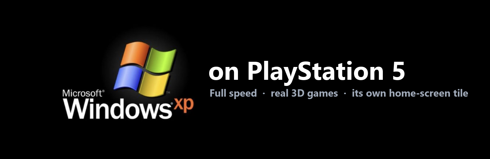

<p align="center"></p>

# Windows XP base project + experimental Windows 10 port

Real Windows XP, running at full speed on a jailbroken PS5, with **its own tile on the PS5 home screen**,
**real 3D games** (OpenGL, Glide and Direct3D through the PS5 GPU), **sound**, a **DualSense** controller,
a modern **web browser**, and a **brightness slider**. Press the tile, and a few moments later you are on the XP desktop.
Shut XP down, and the console turns off.

Tested with: Need for Speed Underground 1 & 2, Midnight Club 2, OpenArena, YouTube in the browser.

## Experimental Windows 10 port

This fork is developing a separate Windows 10 VM path while preserving the original Windows XP setup. The Windows 10 path is **early and untested**; it is not yet a drop-in replacement for the XP experience, and accelerated 3D graphics are not implemented.

- [Windows 10 port notes and setup](docs/WINDOWS10.md)
- [Windows 10 QEMU build script](qemu/build-windows10.sh)
- [Windows 10 VM launcher](linux/windows10/windows10.sh)

The Windows 10 VM requires PS5 Linux with `/dev/kvm`, plus your own Windows 10 installation ISO and license. Build and run QEMU on the PS5 Linux environment; WSL2 is only suitable for editing the project and preparing files.

> **Not affiliated with Microsoft or Sony.** Windows and the Windows XP logo are trademarks of Microsoft;
> PlayStation and PS5 are trademarks of Sony Interactive Entertainment. This project contains **no Windows files,
> no product keys, no games and no Sony files**. You use your own copy of Windows XP.

---

## Contents

- [How it works (in one minute)](#how-it-works-in-one-minute)
- [What you need](#what-you-need)
- [Why 32-bit (x86) Windows XP and not x64](#why-32-bit-x86-windows-xp-and-not-x64)
- [Quick install (one command)](#quick-install-one-command)
- [Easy step-by-step guide](#easy-step-by-step-guide)
- [Everyday use](#everyday-use)
  - [Optional: keep XP off your home network](#optional-keep-xp-off-your-home-network)
- [Known issues](#known-issues)
- [If something goes wrong](#if-something-goes-wrong)
- [For technical people / AI assistants](#for-technical-people--ai-assistants)
- [Credits](#credits)

---

## How it works (in one minute)

1. The **"Windows XP" tile** on your home screen starts PS5 Linux, with a note attached that says "go straight to XP".
2. Linux starts **QEMU**, a program that pretends to be a whole PC. Thanks to **KVM**, the PS5's processor runs
   Windows XP directly, so XP runs at full speed instead of being slowly imitated.
3. **qemu-3dfx** passes XP's 3D graphics to the PS5's real graphics chip, so 3D games run smoothly.
4. When you shut XP down, the PS5 powers off.

You never see Linux; it just looks like the PS5 boots into Windows XP.

---

## What you need

| You need | Notes |
|---|---|
| A **PS5 that can already run PS5 Linux** | This project builds on top of PS5 Linux. Tested on firmware **7.40** with the PS5 Linux loader **v2.5** (CachyOS image) started through the Relapse jailbreak. If you do not have PS5 Linux working yet, set that up first with the PS5 Linux project's own guide; that part is not covered here. |
| **Windows XP Professional SP3, 32-bit (x86)** installation disc image (`.iso`) **+ your product key** | Your own copy. **Must be 32-bit**, see the next section. Not included here and never will be. |
| A **USB keyboard and mouse** (or Bluetooth paired in PS5 Linux) | Plugged into the PS5. |
| A **PC** (Windows, Mac or Linux) on the same network as the PS5 | To copy files to the PS5. |
| A free **GitHub account** | Only to build the home-screen tile installer (GitHub builds it for you, for free). |
| Optional: a **DualSense** controller **on a USB cable** | XP sees it as a normal game controller. Bluetooth does not work for XP. |
| About **15 GB** free on the PS5 Linux drive | XP itself uses ~2 GB; the rest is room for games. |

---

## Why 32-bit (x86) Windows XP and not x64

**Use Windows XP Professional SP3 32-bit (x86). XP x64 will not work here.**

- **It will not even start.** The QEMU built by this project only contains the 32-bit PC (`qemu-system-i386`),
  which is the right machine for XP and keeps the build small and fast.
- **XP x64 is not really XP.** It is a different system built from Windows Server 2003. Almost no drivers were
  ever made for it, and many XP programs refuse to install on it.
- **The 3D parts are 32-bit only.** The 3D pass-through drivers (qemu-3dfx) and the Direct3D layer used for games
  (WineD3D for XP) exist only for 32-bit XP.
- **Old games are 32-bit.** XP-era games and their installers are 32-bit, and some old installers even contain
  16-bit pieces that a 64-bit Windows cannot run at all.
- **Nothing to gain.** The only reason for x64 is more than 4 GB of memory, and XP games do not need it.

---

## Quick install (one command)

If you just want it done: on PS5 Linux open **Konsole** and run these two lines. The installer asks for the location
of your XP disc image and your product key, then does Steps 1–5 and 8.1–8.2 below by itself (it backs up anything
it replaces and never touches your files without saying so; add `--dry-run` to only see what it would do).

```
git clone https://github.com/v0ltfault/ps5-windows-xp.git ~/ps5-windows-xp
bash ~/ps5-windows-xp/install.sh
```

Then continue with **Step 6** (install XP), **Step 7** (drivers, 3D, browser) and **Step 8.3–8.5** (the tile).
Prefer to understand each part? Follow the full guide below instead; it does exactly the same things by hand.

---

## Easy step-by-step guide

Take it slowly: each step tells you what you should see. If you do not see it, check
[If something goes wrong](#if-something-goes-wrong). Words in `grey boxes` are things you type exactly as shown.

> **New to the Linux terminal?** In PS5 Linux, open the app called **Konsole** (the black window with a `>_` icon).
> You type a command and press **Enter**. If it asks for a password, type your PS5 Linux password (nothing shows
> while you type, that is normal) and press Enter. To paste into Konsole use **Ctrl+Shift+V**.

### Step 1 — Get this project onto the PS5

1. Boot your PS5 into PS5 Linux (the desktop) as you normally do.
2. Open **Konsole** and type:
   ```
   git clone https://github.com/v0ltfault/ps5-windows-xp.git ~/ps5-windows-xp
   ```
   ✅ You should see `Cloning into ...` and then `done`.

### Step 2 — Build the special QEMU (one time, ~20 minutes)

1. In Konsole type:
   ```
   bash ~/ps5-windows-xp/qemu/build.sh
   ```
2. It asks for your password once, then downloads and builds. Lots of text scrolls by; that is normal.
3. Wait until the last line says `DONE: /home/<you>/qemu-3dfx/build/qemu-system-i386`.

   ✅ If you see `DONE`, it worked. If it stops with `error`, see [If something goes wrong](#if-something-goes-wrong).

### Step 3 — Make the XP folder and copy your Windows XP disc

1. In Konsole type:
   ```
   mkdir -p ~/xp/floppy && cp ~/ps5-windows-xp/linux/xp/* ~/xp/ && chmod +x ~/xp/*.sh
   ```
2. Copy **your** Windows XP 32-bit `.iso` to the PS5 and name it exactly **`xp.iso`** inside the `xp` folder
   (`/home/<you>/xp/xp.iso`). The easiest way: put the ISO on a USB stick, plug it into the PS5, open the
   **Dolphin** file manager, and drag it into the `xp` folder, then rename it to `xp.iso`.

   ✅ In Dolphin, the `xp` folder now contains `xp.sh` and `xp.iso`.

### Step 4 — Tell XP's installer your product key

1. In Konsole type:
   ```
   cp ~/ps5-windows-xp/guest/winnt.sif.template ~/xp/floppy/winnt.sif && kate ~/xp/floppy/winnt.sif
   ```
2. A text editor opens. Find the line `ProductKey="XXXXX-XXXXX-XXXXX-XXXXX-XXXXX"` and replace the X's with
   **your** key. Optionally change `FullName` and `ComputerName`. Save (**Ctrl+S**) and close.

### Step 5 — Create XP's virtual hard drive

In Konsole type:
```
~/qemu-3dfx/build/qemu-img create -f qcow2 ~/xp/xp.qcow2 40G
```
✅ You should see `Formatting '.../xp.qcow2', fmt=qcow2 ... size=42949672960`.
(It does not use 40 GB right away; it grows as you fill it.)

### Step 6 — Install Windows XP (~20–30 minutes, hands-off)

1. In Konsole type:
   ```
   ~/xp/xp.sh install
   ```
2. A window opens and the blue Windows XP setup starts **by itself**. Do not press anything.
   It restarts a few times. That is normal.
3. When you see the **XP desktop** with the green hill, setup is finished. Click **Start → Turn Off Computer → Turn Off**.

   ✅ The window closes when XP has shut down.

### Step 7 — Install the tools disc: graphics driver, 3D, tweaks

You need a few free downloads from inside XP's world. Put them together in a "tools" disc image:

1. On your PC, download:
   - **VMware SVGA II display driver version 11.9.1** (the Windows 2000/XP driver from VMware Tools 11.x;
     newer 12.x versions only show 16 colors on XP).
   - **WineD3D for Windows XP, version 1.7.52** (from fdossena.com) — makes Direct3D games work.
   - **Supermium** 32-bit (from the win32ss/supermium GitHub releases) — a modern Chrome-based browser that
     still supports XP. **This is your web browser.**
   - The **qemu-3dfx guest wrappers**: build them for free with this repo's GitHub Action
     *build-wrappers* (fork this repo → Actions → build-wrappers → Run → download the `wrappers` file).
   - The **brightness slider**: Actions → *build-bright* → download `bright`.
2. Make a folder called `TOOLS` and put inside: a folder `3DFX` (the wrappers), a folder `SVGA` (the VMware
   driver), a folder `WINED3D`, a folder `SUPERMIUM`, a folder `BRIGHT` (bright.exe + `guest/bright/INSTALL.CMD`), and
   the files from this repo's `guest` folder.
3. Turn the folder into `tools.iso` (on Windows: any free "folder to ISO" tool, e.g. `oscdimg`, ImgBurn, AnyBurn;
   on PS5 Linux: `xorriso -as mkisofs -J -R -o ~/xp/tools.iso TOOLS`) and copy it to the `xp` folder on the PS5.
4. Start XP in a window:
   ```
   ~/xp/xp.sh
   ```
5. Inside XP, open **My Computer**; the tools disc is one of the CD drives.
   - **Graphics:** Control Panel → System → Hardware → Device Manager → the yellow "Video Controller" →
     Update Driver → *Install from a specific location* → point it at the `SVGA` folder. Restart XP the safe way
     (shut down, then start `~/xp/xp.sh` again).
   - Double-click **`RES.CMD`** — sets 1920×1080. XP restarts by itself once.
   - Double-click **`INST3D.CMD`** — installs the 3D pass-through.
   - Double-click **`TWEAKS.REG`** → Yes — turns off slow effects and services (`UNDO.REG` reverses it).
   - Double-click **`FIXD3D.CMD`** — makes Direct3D games fast.
   - **Browser:** copy the `SUPERMIUM` folder to `C:\Supermium`, make a desktop shortcut to
     `C:\Supermium\chrome.exe` and add ` --no-sandbox` to the end of the shortcut's *Target* (right-click →
     Properties). Supermium needs `--no-sandbox` to work properly inside this VM.
   - **Brightness:** run `BRIGHT\INSTALL.CMD` — a sun icon appears next to the clock.

   ✅ XP fills the screen at 1920×1080 in full color, and Supermium opens web pages.

### Step 8 — Make XP start by itself from the tile

This is the part that makes the PS5 boot straight into XP.

1. In Konsole, copy the system files (asks for your password):
   ```
   cd ~/ps5-windows-xp/linux/system
   sudo cp ps5-session /usr/local/bin/ && sudo chmod +x /usr/local/bin/ps5-session
   sudo cp -r ps5-xp.conf.d /etc/X11/
   sudo cp 70-xp-playstation-pads.rules /etc/udev/rules.d/
   sudo cp plasma-autostart.service /etc/systemd/system/ && sudo systemctl daemon-reload && sudo systemctl enable plasma-autostart.service
   ```
   (If your PS5 Linux already starts the desktop with its own `plasma-autostart.service`, compare first; see
   [docs/TECHNICAL.md](docs/TECHNICAL.md#session-start).)
2. Put the XP boot settings next to the normal ones:
   ```
   sudo sh -c 'cat /boot/efi/cmdline.txt | tr -d "\n"; echo " ps5vm=xp"' | sudo tee /boot/efi/cmdl-xp.txt
   ```
   ✅ It prints one long line ending in `ps5vm=xp`.
3. Make the XP version of the Linux loader **on your PC** (needs Python):
   ```
   python patch_loader.py ps5-linux-loader.elf loader-xp.elf
   ```
   using `tile/patch_loader.py` from this repo and the same `ps5-linux-loader.elf` you already use.
   ✅ It prints `patched offset 0x18708`.
4. Build the tile installer on GitHub (free, ~5 minutes):
   1. Fork **https://github.com/itsPLK/ps5-webkit-autoloader** to your account.
   2. Apply this repo's `tile/ps5-webkit-autoloader-tiles.patch` to your fork (`git apply`), and put your
      `loader-xp.elf` at `tiles/xp/loader.elf` (`git add -f tiles/xp/loader.elf` — `.elf` files are ignored by default). Push.
   3. In your fork: **Actions → Build tile installer → Run workflow** (tile: `xp`). Download
      `tile-xp-installer.elf` when it finishes.
5. Install the tile: jailbreak the PS5 as usual (normal PS5 mode, not Linux), send `tile-xp-installer.elf` with
   your payload sender / Payload Manager, choose **relapse** on the page it shows, and reboot.

   ✅ A blue **Windows XP** tile is on the home screen.

### Step 9 — Play

Press the **Windows XP** tile. The screen goes dark for a bit, then XP's desktop appears full screen.
That's it.

---

## Everyday use

- **Start:** press the Windows XP tile (after the usual jailbreak step).
- **Stop:** in XP, **Start → Turn Off Computer → Turn Off**. The PS5 powers off by itself.
  Do **not** just hold the PS5 power button (that is like pulling the plug on a PC).
- **Games:** copy a game into XP with a disc image (`.iso`) or the browser. Direct3D games need the WineD3D files
  (`d3d8.dll`/`d3d9.dll`, `libwine.dll`, `wined3d.dll`) copied into the game's folder. OpenGL games need
  `opengl32.dll` (from the 3D wrappers) copied into the game's folder.
- **Controller:** plug the DualSense in with a USB cable. XP shows it in Control Panel → Game Controllers.
- **Brightness:** click the sun next to the clock.
- **Back to the Linux desktop** instead of XP: just start PS5 Linux the normal way (not the XP tile).

> **"Repairing storage" on the next PS5 start** is normal after using Linux: the PS5's own system never gets a normal
> shutdown when Linux takes over, so it checks the drive once. It is harmless and happens with any PS5 Linux setup.

### Optional: keep XP off your home network

By default nothing on the internet can connect *into* XP (it sits behind QEMU's own NAT and your router), but XP
can still connect *out* to other devices on your home network through the PS5. If XP ever caught malware, it could
try to reach them. This optional setup lets XP reach the internet only. It is **off by default and not part of the
normal install**: if it causes problems for you, turn it off again (below).

One time, in a terminal on the PS5:

```
sudo groupadd -f xpnet && sudo usermod -aG xpnet $USER
sudo cp ~/ps5-windows-xp/linux/system/xp-nolan.nft /etc/xp-nolan.nft
sudo cp ~/ps5-windows-xp/linux/system/xp-nolan.service /etc/systemd/system/
sudo systemctl daemon-reload && sudo systemctl enable --now xp-nolan.service
```

Then in `~/xp/xp.sh` change the line `NOLAN=${NOLAN:-0}` to `NOLAN=${NOLAN:-1}`.

- **Check:** in XP, websites still load, but the address of your router (for example `http://192.168.1.1`)
  no longer opens.
- **What it blocks:** every private address (`192.168.x.x`, `10.x.x.x`, `172.16–31.x.x`, Tailscale's `100.64.x.x`)
  except DNS, which XP needs to look up websites. The rest of the PS5 is not affected.
- **Turn it off:** change the line back to `0`, then `sudo systemctl disable --now xp-nolan.service`.
- Untested on every network setup. If something on your network stops working while XP runs, turn it off.

---

## Known issues

| Issue | What to do |
|---|---|
| **Restart from inside XP crashes the virtual machine.** | Use **Shut Down**, then start XP again. (The launcher automatically restarts XP after a crash, so you will not lose the session.) |
| Games that change resolution in-game may lose their settings. | Set the game's resolution once and leave it. |
| The DualSense works only on a USB cable. | Bluetooth controllers stay with Linux. |
| No widescreen in many old games. | They show 4:3 with black bars (that is the game, not this project). |
| Some monitors lose the picture at 4K or 120 Hz on PS5 Linux. | See **[display-fixes](display-fixes/README.md)**. |

---

## If something goes wrong

| What you see | What it means / fix |
|---|---|
| `build.sh` stops with `error` | Usually a failed download: check the internet and run it again. If it says `patch ... FAILED`, delete `~/qemu-3dfx/qemu-9.2.2` and run again. |
| The install window says *No bootable device* | `xp.iso` is missing or named differently. It must be `~/xp/xp.iso`. |
| Setup asks for the product key | The `floppy/winnt.sif` file is missing or the key line is wrong (Step 4). |
| XP shows only 16 colors | Wrong VMware driver version: use **11.9.1**, not 12.x. |
| The tile only shows the Linux desktop | `/boot/efi/cmdl-xp.txt` is missing or does not end in `ps5vm=xp` (Step 8.2), or the tile was built with the unpatched loader (Step 8.3). |
| Black screen / no signal when a 3D game starts or quits | Wait ~3 seconds: the launcher re-sends the picture automatically. If it stays black, see [display-fixes](display-fixes/README.md). |
| A game crashes at start | Many EA-era games need their registry install key; also try `FIXD3D.CMD`; see the technical guide. |
| Browser does not open pages properly | Add `--no-sandbox` to the end of the Supermium shortcut target. |

---

## For technical people / AI assistants

- **[docs/TECHNICAL.md](docs/TECHNICAL.md)** — full architecture, every file, every QEMU option and patch and why
  it exists, build details, debugging.
- **[AGENTS.md](AGENTS.md)** — an exact, checkable command list for AI assistants (Claude, ChatGPT, …):
  give your assistant this repo and ask it to set things up.
- **[display-fixes/README.md](display-fixes/README.md)** — optional fixes for PS5 Linux picture problems.

---

## Credits

- **itsPLK** — WebKit Autoloader (the home-screen tile is built on it) and the PS5 jailbreak tooling it uses.
- **The PS5 Linux developers** — the loader and kernel this project runs on.
- **kjliew** — **qemu-3dfx**, the 3D pass-through that makes XP games possible. Support the author; please build it
  from source as described here instead of sharing prebuilt copies.
- **fdossena** — WineD3D builds for Windows XP.
- **win32ss** — Supermium, a modern browser for XP.
- **The QEMU project.**

## License

- Scripts, docs, the tile patch and the brightness tool: **MIT** (see [LICENSE](LICENSE)).
- `qemu/patches/*`: **GPL-2.0-or-later**, like QEMU itself.
- `display-fixes/files/ps5_hdmi_fix.c`: **GPL-2.0** (Linux kernel module).
